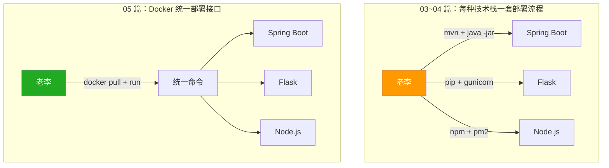
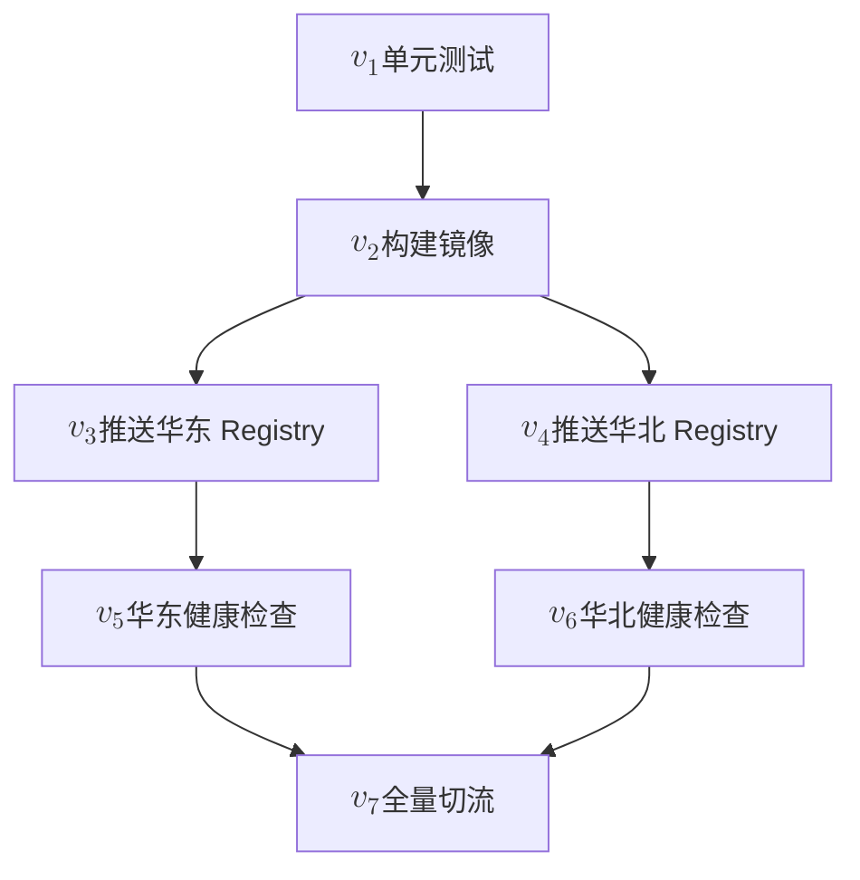
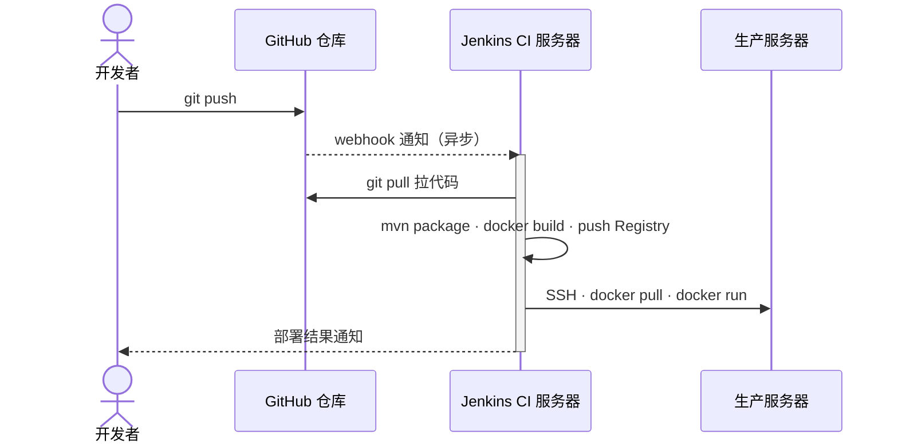

05 篇用 Docker 把「运行环境」封装成不可变镜像，攻克了 03~04 篇留下的可迁移性与服务器污染两大死局。但 05 末尾自己也点明：**每一条部署路径的最后一步，依然要人去执行**。

想象一个真实的上线夜晚——

> 周五晚上 10 点，开发者**小张**把代码合进 `main`，在群里 @运维**老李**：「可以上了」。老李打开终端，`ssh` 登录生产服务器，照着运维文档逐条敲命令——`docker pull`、`docker rm`、`docker run`、`curl /health`。拉取镜像成功，启动新容器时却提示容器名已被占用——他回头排查，发现漏了一步 `docker rm`，旧容器仍叫 app。删除旧容器、重新启动，再做健康检查……上线完成已经 11 点。
>
> 下周一复盘，小张问：「这套动作不能自动化吗？」老李答：「能——但得先把命令写进脚本。」

这就是 06 篇的起点。回看 03~05 篇走过的部署模式，容器化带来了一个重要的**操作收敛**——03~04 篇里，不同技术栈的部署流程各不相同：Java 要 `mvn package` + `java -jar`，Python 要 `pip install` + `gunicorn`，Node.js 要 `npm run build` + `pm2 start`。运维需要为每种技术栈维护一套不同的部署脚本和依赖清单。Docker 把它们统一为同一条命令 `docker pull` + `docker run`——**运维只需要懂 Docker，不再需要为每种技术栈维护不同的部署流程**：



镜像统一了常见的部署接口，但还没有消除重复操作。每次上线仍要手工执行同一组命令，下一步就是将这些步骤固化为脚本。

这一篇做两件事：

1. **把重复命令固化成 shell 脚本**——老李不再每次敲同样的命令，而是把「上次怎么做的」沉淀为「这次跑一下脚本就行」，自动化运维的第一步；
2. **介绍 Jenkinsfile**——把流程与脚本放进代码仓库，配合已配置的触发器执行；先理解流水线即代码，再与基础设施即代码的思路对照。

## 从手动到自动：把上线步骤写进脚本

先把拉镜像、停旧容器、启动和健康检查写进 `deploy.sh`。示例在目标服务器本地执行，假定已安装 Docker、已登录镜像仓库，并已导出 `DB_URL`；`your-registry/app` 需要替换为实际镜像地址。

```bash
#!/usr/bin/env bash
set -euo pipefail
: "${DB_URL:?DB_URL is required}"
image="your-registry/app:${VERSION:?VERSION is required}"
docker pull "$image"
if docker container inspect app >/dev/null 2>&1; then
  docker rm -f app
fi
docker run -d --name app -p 8080:8080 \
  -e DB_URL="${DB_URL:?DB_URL is required}" "$image"
sleep 5
curl -fsS http://localhost:8080/health
```

将脚本保存到目标服务器后，在该目录指定版本执行。统一使用环境变量传参，不依赖可执行权限：

```bash
VERSION=1.2.0 bash ./deploy.sh
```

这是有中断窗口的教学示例：旧容器删除后才启动新容器，固定等待 5 秒也不保证就绪。生产发布还需设计健康检查重试、失败恢复与回滚，不能直接照搬。

**对比改动**：每次上线还是需要 SSH 一次，但**剩下的命令交给脚本**——执行顺序被固定下来，便于检查与复用；`set -e` 有适用例外，不能替代健康检查和失败处理。

### 把 05 篇的 job 接到脚本上

05 篇的「最小生产变更」已经定义了 4 个 job：

- $J_1$（**DB**）：装 MySQL / 导入 schema / 启动服务
- $J_2$（**App**）：部署 Spring Boot
- $J_3$（**Nginx**）：写 `nginx.conf` / `nginx -s reload`
- $J_4$（**verify**）：`curl -fsS /api/health`

**关键点**：自变量 $x$ 的**范围**决定要跑哪些 job——**不是每次都全量跑 4 个**。

- 只改了前端代码 → 整个 App job 都不用跑（DB 也不动）；
- 只改了 `nginx.conf` → 只需要重载 Nginx，App / DB 都不需要动；
- 只改了 DB schema → 才需要 $J_1$；同时改了 App → 还需要 $J_2$。

所以 05 篇的「4 个 job」不是说每次上线都要全打一遍——而是**根据 $x$ 的范围按需挑选**。

**复杂度降级**：job 内的串行步骤从 $n$ 收编到 1。05 篇在单个 job 内部留下 $n$ 个串行步骤（ssh → pull → rm → run → sleep → curl……），每一步都是一次独立的执行单元：漏一步、记错顺序、心慌；本篇就是要把这 $n$ 步收编到一个 shell 脚本里。

前面的 `deploy.sh` 已经实现应用任务，不必再抄一份部署逻辑。若统一按任务命名，可在同一目录用 `app.sh` 作为入口：

```bash
#!/usr/bin/env bash
set -euo pipefail
exec bash ./deploy.sh
```

这里假定从脚本所在目录调用。`app.sh` 会继承环境变量中的版本与配置：

```bash
VERSION=1.2.0 bash ./app.sh
```

所有 $n$ 步都被收编到一个 `.sh` 文件里，对外只剩一次调用——步骤与错误处理可以一起版本管理；`set -euo pipefail` 能暴露部分错误，但不是自动回滚或可靠性的保证。

> 这就是脚本化的核心收益：把 $n$ 步的实现细节封装到 1 次调用背后。

对于确有先后依赖的任务，可以用 `&&` 串联。下例约定各脚本继承 `VERSION` 环境变量，而不是读取位置参数；`db.sh`、`nginx.sh`、`verify.sh` 需另行提供，且按退出状态报告结果：

```bash
export VERSION=1.2.0
bash ./db.sh && bash ./app.sh && \
  bash ./nginx.sh && bash ./verify.sh
```

`&&` 仍然只表达**串行**——05 篇的「$J_1 \to J_2 \to J_3 \to J_4$」拓扑序，用 shell 的串行原语压扁成一行。**单 job 内部是脚本，job 之间的串联也是脚本**——这只是当前示例选择的串行组织方式，shell 也支持后台任务与额外调度逻辑。

### 对 shell 脚本的初步划分：job 与 step

把上面的 4 个 job 落到工程实践里，会自然长出两个粒度的拆分——**job 与 step**：

- **job**：对一个**完整目标**的封装——把「把 DB 起好」「把 App 部署完」这类业务动作打包成**一个独立的 shell 文件**（`db.sh` / `app.sh`）；
- **step**：job 内部更细的子动作——`docker pull`、`docker run`、`mysql ping`、`curl /health`。

常见的划分原则有三条：

1. **前后端分开**：`app.sh` 进一步拆成 `frontend.sh` 和 `backend.sh`——失败域隔离，前端没起好不会拖垮后端，可以单独重跑；
2. **verify 内置到 job 作为 last step**：每个 job 跑完不是「无脑返回 0」，而是自己在最后用 `curl` 或 `mysql ping` 验证一下，确认**这个 job 的约定结果**真的达成了；不像 04 篇那样「上线靠记忆」；
3. **job 之间用 `&&` 串联**：依赖关系靠 shell 的串行原语表达——前面的 job 没成功，后面的 job 不会启动。

回看唯一的完整部署示例：`docker pull`、删除旧容器、`docker run` 是部署 step，最后的 `curl` 检查单个应用是否就绪。任务之间的 `verify.sh` 则可用于跨服务的集成验证；两者检查范围不同，不必重复实现相同检查。

把 job / step 拆分明确后，简单任务已经可以用脚本组织。随着机器、依赖和失败情况增加，需要额外维护的调度逻辑也会增多。下面分别看任务编排与任务可靠性两个问题，再判断哪些工作适合交给流水线引擎。

> **术语**：到这里，「**命令式**」（imperative）的含义已经很直观了——一步步告诉系统**做什么、按什么顺序做**，shell 脚本就是典型。本篇接下来的关键转折点是：**shell 不提供现成的 DAG 调度模型，依赖、并行与失败传播需要额外维护**——这是升级到流水线引擎的根本原因。

### 边界一：多机协作与并行拓扑

业务从单台服务器扩到 5 台、10 台、100 台时，「同一份 `deploy.sh`」要在 $N$ 台机器上各跑一次。最直接的 shell 写法是 `for server in ...; do ssh ...; done`——这是**串行**展开，遇到慢的机器、慢的网络会拖垮整体进度。真实场景里这 $N$ 台机器之间的部署**有并行机会**：先全量重启前 5 台、健康检查通过后再并行重启后 5 台。

命令式 shell 想做的是「**按拓扑序执行**」——$v_3$ 与 $v_4$ 没依赖就并行、$v_7$ 必须等 $v_5$ 与 $v_6$——也可以用 `&` 启动后台任务、用 `wait` 等待，但依赖和失败传播还需要自己管理：

```bash
ssh h1 "./app.sh" &
ssh h2 "./app.sh" &
ssh h3 "./app.sh" &
wait
```

上面的单次 `wait` 可以等待多个后台任务；在 Bash 中不带参数的 `wait` 也不能替代逐个任务的成功检查。它不会自动建立任务依赖，任务的退出状态、失败后是否继续、重试与取消仍需自己管理。困难在于这些控制逻辑随流程复杂化而增加，不是每多一台机器就必须多写一次 `wait`。


::: details 📐 静态信息图 Prompt 与路径参考（左侧：shell 命令流 / 右侧：DAG 依赖图）

**Prompt**：

```text
极简手绘马克笔信息图，16:9 横版。主题为「shell 命令流 vs DAG 依赖图」：
- 左侧「shell 命令流」：自上而下 5 条命令序列方块（h1, h2, h3, h4, h5），
  每条都是 ssh + ./app.sh；h1/h2/h3 末尾各有一个 "&" 标记，h3 之后接
  一个虚线框「wait」；最下方红色标签「并行靠硬模拟 · 维护成本指数上涨」
- 右侧「DAG 依赖图」：顶部 1 个「build」节点向下展开为 h1/h2/h3/h4/h5
  共 5 个并列节点（横向并排、无连线），下方一个「healthcheck」节点
  接收来自 5 个节点的箭头汇入；右侧绿色标签「引擎按图自动调度」
左右两栏用一条细灰线分隔；顶部居中标题「边界一：shell 无法建模生产变更的操作拓扑」。
暖白背景、黑色线稿；所有自然语言使用简体中文；无阴影、无渐变、无 3D。
```

- 产物路径：`docs/public/images/img-pipeline-basics/infographic-shell-flow-vs-dag.png`
- 站点引用：`https://media.xiaolin.fun/docs/img-pipeline-basics/infographic-shell-flow-vs-dag.png`

:::

**边界一的本质**：shell 可以实现并行和依赖控制，但需要额外代码维护任务关系、退出状态、重试与取消。DAG 将依赖显式化，流水线引擎再根据定义调度执行，减少自行维护调度逻辑的负担。

引入流水线引擎的根本动机，就是把「按拓扑序执行」从「shell 里硬模拟」升级到「引擎读 DAG 自动调度」——下一节的 DAG 就是这条路的展开。

### 边界二：shell 脚本的健壮性陷阱

边界一是「能不能表达拓扑」，边界二是「**表达对了能不能稳定跑**」——这是代码层面的问题，与拓扑无关。

在终端里根据手册敲指令，是一种**随机应变**的过程：人可以读报错、现场判断、决定下一步——「这个文件不存在就跳过」「这一步报错就回滚」「看起来不对先 abort」。这种灵活是**人**提供的，不是命令本身提供的。

**shell 脚本把这件事翻转了**——它意味着「所有操作预期都完成」：每一步都按事先写死的逻辑跑，没有人会现场救你。**两层后果**随之而来——

**在独立、等失败率的假设下，步骤累积会降低整体成功率**——$n$ 个独立步骤，每个步骤的成功率 $(1-p)$（如 $p = 0.01$），整条流水线的成功率 $(1-p)^n$ **随 $n$ 指数下降**。5 步约 $95\%$，15 步就只剩 $86\%$。这个估算依赖上述假设，不意味着真实任务相互独立或失败率相同，也不特指 shell。

**失败模式不可预测**——网络抖动、磁盘满、镜像拉取超时、API 限流、配置漂移……每一种都可能让一个步骤不按预期走。脚本不会停下来问你「下一步怎么办」，它只会按事先写好的逻辑硬跑，要么继续、要么 `exit 1`。

**防御性编程的诱惑**——现实里 shell 不可避免地演化出这些补丁：

```bash
docker rm -f app || true  # Ignore all removal errors
sleep 5 || true                     # Ignore sleep failure
curl -fsS ... || curl -fsS ...      # Retry once
[ -f /tmp/xxx ] && rm -f /tmp/xxx   # Remove only if the file exists
set -euo pipefail  # Expose errors; some contexts are exempt
```

`|| true`、`set -e`、`&&` 串联……每出现一次新失败模式就加一条防御，**写到最后都是补丁代码**：核心逻辑被层层防御淹没，新人接手时已经看不出「这个脚本到底想干什么」。

**Shell 适合组合已有命令，也可以按工程要求维护。** 问题在于错误处理是否明确：哪些失败允许忽略、哪些必须退出、谁负责恢复。无差别添加 `|| true` 会隐藏异常；必要的校验、超时和日志则应保留。当调度与异常处理挤压主要业务动作时，可以将部分职责交给引擎或更合适的程序实现。

**边界二的本质**：自动执行需要明确成功条件、失败策略和恢复责任。流水线引擎可以提供超时、重试、日志等机制，但能否安全重试、如何回滚、如何确认业务结果，仍取决于任务实现和发布方案。可靠性来自脚本、执行环境、验证与恢复机制的配合。

事务、数据库迁移、版本回滚、生产审批与灰度发布分属不同层次，需要应用、发布平台和组织流程共同设计。Terraform、K8s 等工具可承担其中部分资源或工作负载管理职责，并不自动提供完整兜底；后续文章再分别展开。

### 流水线引擎解决了哪个

把这两个边界与 06 篇的命题对齐：

- **边界一**：流水线引擎是「**解药**」——它用 DAG 拓扑替代硬模拟并行，用引擎调度替代手工 `&&`；
- **边界二**：流水线引擎是「**配角**」——shell 脚本的健壮性仍要靠脚本自身、IaC 工具、组织流程来兜底。

下一节展开——**流水线引擎如何面向 DAG 建模**，将依赖与调度集中管理。

## 流水线引擎：面向 DAG 建模

相对 02 篇的线性 $Y=\{v_1, v_2, v_3\}$（构建 → 上传 → 验证），本篇的 $Y$ 因「并行拓扑」扩容——$v_3$ 与 $v_4$ 可同时执行，$v_7$ 必须等 $v_5$ 与 $v_6$ 都完成。$Y$ 从线性序列升级为 DAG，运维动作 $f$ 仍保持闭合（每个节点仍是 shell 脚本），但调度方式从「人按顺序执行」升级为「引擎按拓扑序调度」。

继续把 $f$ 拆细：**生产变更**很少是「一条直线」。它通常长得像这样——**有先后、有并行、有汇总**：



这种「局部并行、整体有序」的拓扑，**线性箭头写不出来**——$v_3$ 与 $v_4$ 之间没有依赖，可以同时跑；$v_7$ 必须等 $v_5$ 和 $v_6$ 都成功。

把它抽象成数据，就是一张**有向无环图**（Directed Acyclic Graph, **DAG**）：

- **节点 $v_i$**：每一个具体动作（pull / build / test / deploy / check）；
- **有向边 $v_i \to v_j$**：$v_j$ 必须在 $v_i$ 完成后才能开始；
- **无环**：从任意节点出发沿边走不会回到自己——排除图内的循环依赖，但不能保证任务不会因锁、网络或外部资源而阻塞；
- **拓扑序 $\tau$**：满足所有边方向的一个节点排列，是 $f$ 实际可执行的顺序。

DAG 自然支持**并行**：不存在直接或间接先后依赖的节点，在资源与并发限制允许时可以并行执行；只有存在路径 $v_i \to v_j$ 时才有先后。这种「局部并行、整体有序」是现实工程里**最常见**的形态——比纯线性链条更接近真实流程。

### 流水线引擎是什么

**流水线引擎**（Pipeline Engine）是「读 DAG、按拓扑序调度执行」的中间层。它要做的事不复杂，归结起来五件：

- **读**：解析一份声明文件（YAML / Groovy DSL），把节点和依赖关系建立成 DAG；
- **调度**：按拓扑序决定节点执行顺序与并行度，自动起 worker；
- **触发**：监听 webhook / 定时 / 手动，接收变更信号；
- **运行**：把节点分发给合适的执行机（agent / runner），记录 stdout / stderr；
- **收尾**：成功 / 失败 / 不稳定分别处理（post 块），发送通知。

> **一句话定义**：流水线引擎 = 「**DAG 解析器 + 拓扑序执行器 + 触发与通知中心**」。

它本质上就是为「shell 硬模拟并行 / 手工 `&&`」而生的替代品——引擎直接读 DAG、自动调度，集中管理 06 篇讨论的依赖与调度。

### 流行的流水线工具一览

| 工具 | 形态 | 声明语法 | 推荐场景 |
| :--- | :--- | :--- | :--- |
| **Jenkins** | 自托管 | Groovy DSL（Jenkinsfile） | 传统架构、深度定制、插件生态最丰富 |
| **GitHub Actions** | SaaS | YAML（`.github/workflows/*.yml`） | 个人 / 开源项目首选，模板即开即用 |
| **GitLab CI** | 自托管 / SaaS | YAML（`.gitlab-ci.yml`） | 与 GitLab 仓库一站式集成 |
| **Tekton** | 自托管（K8s 原生） | YAML | K8s 深度用户，流水线即 K8s CRD |
| **Argo CD** | 自托管（GitOps） | YAML / Kustomize | 云原生 GitOps 持续部署 |
| **阿里云效 / 腾讯云 CNB** | SaaS | YAML | 国内云生态、企业研发协同 |

> 07 篇会展开 **GitHub Actions** 作为托管式流水线的代表；本篇剩余以 **Jenkins** 为代表，介绍 Jenkinsfile 与流水线语法。

### 角色分工：人定义任务，引擎组织执行

到这里，06 篇的核心命题可以用一句话收束——**将流程定义与任务调度分开：工程师维护任务、依赖和执行条件，引擎按定义组织运行。**

工程师定义任务、依赖、成功条件与运行配置，引擎据此安排执行、收集日志和报告结果。执行节点、并发限制、凭据权限、超时与审批都需要明确配置；使用引擎并不意味着这些工程工作可以省略。

这里的关注点分离，是把流程定义、调度机制和任务实现分别维护。DAG 表达执行依赖，不等同于对基础设施期望状态的声明。人仍需审查定义和结果，引擎按已配置的机制运行。

## Jenkins：把运维动作托管给独立引擎

前面的章节用 shell 脚本固化命令序列、用 DAG 把动作拓扑画出来、用流水线引擎解决「shell 硬模拟并行」的边界一，但**谁来运行这些脚本、跑得对不对、有没有日志、谁能在什么时候触发**，脚本自身回答不了。**Jenkins** 就是为这些问题而生的 CI/CD 引擎——本节先介绍 Jenkins 自身（是什么、5 项基本能力、典型架构），再讲它在 06 篇里的角色：从早期最小部署、Jenkinsfile 把脚本纳入仓库，到平面分离思考与 Controller/Agent 演进，最后以运维左移收尾。

### Jenkins 是什么

**Jenkins** 是目前最流行的**自托管持续集成**（CI）**引擎**，由 Java 编写、2004 年开源、插件生态极其丰富。它的核心定位是——**把「构建 + 测试 + 部署」这套动作从开发者的笔记本剥离出来，集中到一个独立、可信、可审计的执行平台**。

**5 项基本能力**：

- **监听触发**：webhook（`git push`）、定时（cron 表达式）、手动点击、上下游任务触发；
- **构建执行**：在 agent 上跑 shell / Maven / Gradle / Docker 等命令，串行或并行；
- **日志收集**：收集任务输出，按配置保留、查询与归档日志；保留期限与存储能力有关；
- **结果通知**：邮件 / Slack / 企业微信 / Webhook——失败时按预设动作推；
- **权限管理**：用户 / 角色 / 凭据（Credentials Store）——谁能触发、谁能批准、谁能改流水线。

**典型架构**：**Controller + Agent**——Controller 负责协调（监听、解析、派发、收集、通知），Agent 才真正跑命令。这层分离让 Jenkins 能横向扩展，也能应对多语言、多环境的任务。

Jenkins 不是唯一的 CI 引擎，但它有几个独特点——**自托管**（数据与构建都在自己的服务器上）、**插件生态最丰富**（1500+ 插件）、**声明文件 Groovy DSL**（Jenkinsfile，下几节展开）。理解了 Jenkins 就理解了「CI/CD 引擎」这件事的标准形态。


### 早期最小方案：一台 CI 服务器兼顾构建与部署

Jenkins 最早、最朴素的部署形态就是：一台专门的服务器，自居「CI server」，装 JDK / Maven / Git / SSH / Docker，监听 `git push` 的 webhook，自动跑构建并部署到生产。



部署步骤大致是：

1. 在 Jenkins 这台机器上：监听 `git push` → `git pull` 拉代码 → `mvn clean package` 打 jar → `docker build` 打镜像 → `docker push` 到 Registry；
2. SSH 到生产服务器：`docker pull` → `docker rm -f app` → `docker run ...`。

Jenkins 服务器装 JDK / Maven / Docker 是它的本职工作（构建 + 镜像）；生产服务器只跑容器，05 篇确立的「服务器回归本职」在这里被严格遵守。两者职责清晰、不交叉污染。这就是「独立使用一个虚拟机来部署和管理多台虚拟机和应用进程」的最朴素形态。


### Jenkinsfile：把生产变更脚本提前写好

早期最小方案已经能跑，但**运维动作如何沉淀**这件事仍然不优雅。

在 CI 服务器上启动 Jenkins 服务（直接运行或 Docker 启动）后，运维人员通过浏览器登录到 Jenkins 提供的 Web UI 进行管理：

- **手动写 shell**：构建步骤都写在 Jenkins UI 的文本框里，「Build Steps → Execute shell」里直接敲 `mvn package`、`docker build`、`ssh ... docker run` 等命令；
- **手动配密钥**：数据库密码、SSH 私钥、镜像仓库 token 都在 Jenkins Credentials 界面里逐条添加；
- **手动配环境变量**：每个 job 的参数化构建、触发器、环境变量都在 UI 上点点填填。

这套做法的痛点很直接：

- **可迁移性极差**：所有配置绑死在 Jenkins 实例里——一旦 Jenkins 进程崩溃、服务迁移、Jenkins 升级失败需要重装，这些**手动敲的命令、配置的环境变量、添加的凭据全部丢失**；
- **没有审计**：UI 上谁改了什么、什么时候改的——**没有可追溯记录**，多团队协作时尤其痛苦；
- **没有 review**：构建步骤改了，没法走 PR review；改错了回滚只能凭记忆；
- **没有版本管理**：配置改了就改了，**没有 diff、没有回滚**——退回到 04 篇之前那种「上线靠记忆」的状态。

Jenkinsfile 就是为了解决这些问题——**把生产变更的脚本提前写好、纳入代码仓库**：

```text
your-app/
├── src/                ← 应用代码
├── pom.xml
├── Jenkinsfile         ← 流水线声明（与代码同仓库）
└── README.md
```

Jenkinsfile 是放在仓库根目录的文本文件，由 Jenkins 引擎读取并执行。它把原本散落在 UI 里的构建步骤**沉淀为一份可 review、可版本管理的代码**——这就是 06 篇开篇所说的「**把命令序列写进文件**」在 Jenkins 世界的具体落地。

> 早期 UI 配置的真实样子：Blue Ocean 是 Jenkins 现代化的流水线编辑入口，下面是从 GitHub 仓库导入流水线的 UI——所有配置、shell 命令、密钥都手动点点填填。

### Jenkinsfile 与 shell：先看整体，再展开步骤

前文用 shell 固化了单个任务。接下来要解决的是：把数据库、应用部署和验证三个任务组织起来，并将流程定义放进 Git。这里先看整体，再按语法包含关系展开，避免把凭据、SSH 和 Docker 命令挤进同一段代码。

**先看整体骨架。** 以下 Jenkinsfile 用三个阶段表达任务顺序。示例假定仓库提供 `db-job.sh`、`app-job.sh` 和 `verify.sh`；它们是任务接口，不是 Jenkins 自带命令。脚本实现、执行节点工具及环境配置仍需实际准备，本例不是可直接用于生产的部署方案。

```groovy
pipeline {
  agent any
  stages {
    stage('DB') {
      steps { sh 'bash ./db-job.sh' }
    }
    stage('App') {
      steps { sh 'bash ./app-job.sh' }
    }
    stage('Verify') {
      steps { sh 'bash ./verify.sh' }
    }
  }
}
```

先记住包含关系：`pipeline → stages → stage → steps → 具体步骤`。`agent` 与 `stages` 同属于流水线配置，用来声明执行环境；它不是执行阶段。下面的局部片段逐层展开职责，包含重复上下文，不能顺序拼接成另一个完整文件。

**展开阶段：stage 表达一个目标。** 以应用部署为例，阶段名是 App，内部的 steps 声明要执行的动作。

```groovy
stage('App') {
  steps {
    sh 'bash ./app-job.sh'
  }
}
```

**展开步骤：steps 中排列具体动作。** `sh` 是执行 Shell 命令的具体步骤，不需要再套一个名为 `step` 的容器。下面展示同一阶段内先部署、再验证的另一种组织方式；若采用这种安排，就需要相应调整整体骨架，避免重复执行验证。

```groovy
steps {
  sh 'bash ./app-job.sh'
  sh 'bash ./verify.sh'
}
```

**展开凭据：只包住需要凭据的步骤。** 如果应用任务需要通过 SSH 连接目标主机，可以在该阶段的 steps 内使用凭据绑定。下面是替换该阶段 steps 内容的局部结构，不是独立 Jenkinsfile。

```groovy
withCredentials([sshUserPrivateKey(
  credentialsId: 'app-key',
  keyFileVariable: 'SSH_KEY'
)]) {
  sh 'bash ./app-job.sh'
}
```

`app-key` 是需要预先配置的 SSH 私钥凭据 ID。绑定把密钥文件路径通过 `SSH_KEY` 提供给内部步骤；不会自动登录服务器，也不会自动让脚本使用该密钥。脚本必须显式读取变量并配置目标主机与主机身份校验。

**最后展开脚本：具体命令在明确的环境中执行。** `db-job.sh` 负责数据库变更，`app-job.sh` 负责应用部署，`verify.sh` 负责检查约定结果。Jenkins 的 `sh` 先在所选 agent 上执行；需要远程部署时，由任务脚本负责 SSH 调用。前文的本地 Docker 部署脚本只能作为动作示例，不能未经调整就当成远程任务脚本。

这套拆分把两个问题分开：Jenkinsfile 表达任务顺序与凭据作用域，shell 文件实现动作。完整代码可以分文件维护，不必为了把所有内容塞进一个代码块而写出多层嵌套的长命令。

流程进入仓库后，主要改善的是以下几件事：

- **编码位置**：从 Jenkins 页面中的命令文本框，转向与业务代码同仓库的流程文件，便于一起 review。
- **可迁移性**：Git 能带走流程和脚本；凭据、插件、执行节点及工具链仍需单独配置，不是零配置迁移。
- **部署触发**：Jenkinsfile 定义如何执行；自动执行还需要 webhook 或其他触发配置，也可以保留手动触发。
- **可追溯性**：流程变更可通过 Git 历史与 PR 审查追踪；Jenkins 运行记录及管理操作审计还取决于平台配置。

目标主机、环境变量、凭据与健康检查地址应作为明确的配置管理，不混进不可读的命令长串。下一篇再结合 GitHub Actions 展开这些配置如何注入。


### 流程可迁移，环境仍需配置

Jenkinsfile 让流程定义与任务脚本随 Git 保存，便于审查和复用。迁移到另一套 Jenkins 时，还需要检查以下条件：

- **执行环境**：agent 的工具版本、网络、权限和工作目录是否满足任务要求。
- **路径与配置**：仓库 checkout 后脚本是否存在，目标主机和环境参数是否正确。
- **凭据引用**：凭据 ID 与权限是否已配置；版本管理不会自动带走密钥。
- **运行记录**：日志保留、归档和管理操作审计是否按需要配置。


这些条件可以帮助复现运行环境，但任务内部的正确性、健康检查和回滚仍需单独设计。流程进入 Git 改善了变更追踪，不代表环境和可靠性自动达标。

## 思考与架构演进

### 控制平面与业务平面

回过头看早期最小方案，**它其实已经暗含了一个重要的架构原则：把环境拆成两个平面**。

以典型的 5 台服务器为例：

- **控制平面（1 台）**：部署 Jenkins + CI 构建所需的依赖库（JDK / Maven / Git / SSH / Docker），承担 webhook 监听、代码拉取、镜像构建、部署调度——**不承载对外生产业务**；
- **业务平面（4 台）**：每台只部署 Docker，只承载业务进程、提供服务——05 篇确立的「服务器回归本职」在这里被严格遵守。

控制平面与业务平面的关键区分：

- **职责分离**：控制平面负责「**如何跑**」（构建 + 部署 + 调度），业务平面负责「**跑什么**」（业务进程 + 服务）；
- **资源隔离**：构建任务是 CPU / 内存密集型（`mvn package` / `docker build`），把它放在业务服务器上会与线上请求抢资源——05 篇的两难死局之一；
- **故障隔离**：控制平面挂掉，业务平面仍能继续服务（只是新版本发布受影响）；业务平面挂掉，控制平面仍可重新部署；
- **权限边界**：构建、部署与业务运行分别按需授权。业务服务器拉取私有镜像时仍可能需要仓库凭据；分开机器不等于自动完成安全隔离。

> **架构上可以混部**（让一台服务器部分承担两种角色），**但不推荐**——单台故障同时影响控制 + 业务、构建资源争抢线上请求、凭据管理边界模糊，这些都是混部会复发的常见痛点。

Jenkins 的 controller 负责协调，agent 承担具体任务；再将构建执行资源与线上业务资源分开，可以减少相互影响。K8s 也区分控制平面与工作节点，但组件职责和安全边界不同，不宜与 Jenkins 角色一一对应。

### 运维左移：把运维动作编程为基础设施，提交到 Git

传统运维的场景大致是这样的：

1. 开发完成后，由开发人员**交付一个运维文档**——或是对开发架构的基本介绍，或是最基础的部署步骤介绍；
2. 没有特别添加的内容，**生产变更由运维重复执行**——读文档、手动 ssh、敲命令、记笔记；
3. 如果有添加的内容，**更新运维文档**，再交付给运维。


::: details 📐 静态信息图 Prompt 与路径参考

**Prompt**：

```text
极简手绘马克笔信息图，16:9 横版。主题为「传统运维场景：开发面向运维人员交付」：
- 左侧「开发角色」：开发者人物头像 + 笔记本电脑图；笔记本电脑屏幕里
  显示代码窗口；开发者手里拿着一份 Markdown 文档图标；左上方蓝色
  标签「开发交付运维文档」
- 中间「手动交接线」：一条虚线箭头从左侧指向右侧，箭头中标注
  「人工交接 · 靠记忆/文档」；中间红色标签「面向人」
- 右侧「运维角色」：运维人员人物头像 + 服务器机柜图；运维人员
  正在用 SSH 客户端连服务器，命令行终端闪烁；服务器图标里跑着
  一摞进程方块；右上方黄色标签「读文档 + 手动敲命令」
左右两栏用一条细灰线分隔；底部统一一条横线标注
「运维手册面向人 · 文档是载体 · 人是执行者」。
暖白背景、黑色线稿；所有自然语言使用简体中文；无阴影、无渐变、无 3D。
```

- 产物路径：`docs/public/images/img-pipeline-basics/infographic-traditional-ops.png`
- 站点引用：`https://media.xiaolin.fun/docs/img-pipeline-basics/infographic-traditional-ops.png`

:::

这类交接以文档和人工操作为主。文档本身仍有价值；问题在于部署动作、验证条件与变更历史如果只留在个人记忆中，就难以复现和共同审查。可以把适合自动化的动作写成代码，同时保留环境说明与操作边界。

- **交接靠记忆、靠文档**——没有可审计；
- **部署靠人**——没有可迁移（换人 / 换机器都要重新积累）；
- **故障排查靠经验**——没有可追溯。

**运维左移，是将发布要求和运行约束提前进入开发与审查阶段。** 开发维护应用相关的构建与验证逻辑，运维或平台人员参与目标环境、权限、发布条件与恢复方案的设计。具体分工由团队确定，代码化减少重复交接，不消除生产责任。

落地时，可以共同编写流程与脚本，通过 PR 审查，把版本和配置纳入管理；再配置触发、执行节点与审批条件，让引擎执行已审查的任务。事后结合 Git 变更、任务日志和平台审计记录排查；记录的范围与保留期限需要单独配置。

走完这 4 步，前后变化是这样的——

- **角色分工**：从「开发面向运维人员交付」→「**开发面向运维工具交付**」；
- **上线步骤**：从「某个人脑子里的隐性知识」→「仓库里显性、可版本管理的代码」；
- **事故排查**：从「经验 + 翻日志」→「Git 历史 + Jenkins 控制台 + 任务运行记录」。

> **运维左移把部署定义、验证条件和审查提前，不把生产责任一并交给工具。** 生产授权、发布审批、故障处置与回滚仍需明确负责人。

Jenkinsfile 属于流水线即代码，Terraform 等工具侧重基础设施资源管理。二者共享版本管理和代码审查的方法，但职责不同；把部署命令放进 Git，并不等于已经实现完整的基础设施管理。

回到开头的上线场景：老李可以从逐条敲命令，转为检查变更、确认环境与发布条件，由引擎执行经审查的流程。配置好触发器后，代码变更可以启动任务；是否自动进入生产、何时需要审批，由团队明确决定。

## 流程旁白

本篇以开发维护应用相关脚本、运维参与生产配置审查为例。配置 webhook 或其他触发器后，代码变更可以触发 Jenkins；生产审批、执行权限和失败处置仍需单独安排。具体职责可以由同一人承担，但各项责任都需要明确。

## 小结

本篇从重复的上线动作出发：先用脚本固化单个任务，再用 DAG 表达依赖与并行，交给流水线引擎组织执行。Jenkinsfile 让流程进入 Git，便于共同审查与追踪；脚本、执行环境、权限、健康检查和恢复方案仍需维护。运维左移的价值，是把这些要求提前纳入协作，而不是让工具替代生产责任。

下一篇 [07 篇 · GitHub Actions](./07-actions.md) 用托管式流水线继续展开，重点看 YAML 配置、触发条件和执行环境如何配合。

## 思考

1. 把上线步骤固化进 `deploy.sh` 之后，「幂等」具体怎么保证？脚本里哪一行最容易因为重跑而炸？
2. 如果自行用 shell 管理依赖与并行，要让 $v_3$ 与 $v_4$ 并行、$v_7$ 等 $v_5$ 与 $v_6$，你会怎么写？这种写法有哪些脆弱点？
3. Jenkinsfile 把脚本纳入代码仓库，让生产变更可追溯、可复用。这种「文件即基础设施」的思路，与 05 篇的 Docker 镜像封装有什么异同？

## 延伸阅读：自动执行之后，如何可靠发布

### 失败后重试，为什么可能越试越错

本文把多步操作封装成脚本，但任务超时不代表它没有执行成功。直接重跑，可能重复创建资源或重复执行数据库变更。下一步值得了解的是幂等：如何让重复执行不产生额外副作用。

推荐阅读 [AWS Builders’ Library：Making retries safe with idempotent APIs](https://aws.amazon.com/builders-library/making-retries-safe-with-idempotent-APIs/)。它以 API 为例说明重试与副作用的关系；先理解“结果未知”与“安全重试”，再思考这个原则如何应用到部署任务，不必在本篇深入其具体实现。

### 流水线跑成功，为什么还不能立即全量发布

本文的 DAG 最后汇聚到全量切流，但检查通过不代表新版本在真实流量下没有问题。金丝雀发布先让少量流量使用新版本，观察后逐步扩大，并保留退回旧版本的路径。

推荐阅读 [Canary Release](https://martinfowler.com/bliki/CanaryRelease.html)。本篇先理解控制影响范围的思路：何时扩大流量、观察什么、何时停止；具体实现留到后续。

## 参考

1. [Jenkinsfile 语法参考](https://www.jenkins.io/doc/book/pipeline/syntax/)
2. [基础设施即代码（IaC）概览](https://en.wikipedia.org/wiki/Infrastructure_as_code)
3. [Terraform 文档](https://developer.hashicorp.com/terraform/docs)
4. [GitHub Actions 文档](https://docs.github.com/en/actions)
5. [Kubernetes 文档](https://kubernetes.io/docs/home/)
