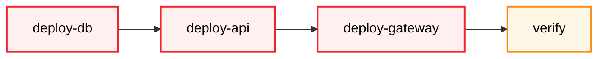
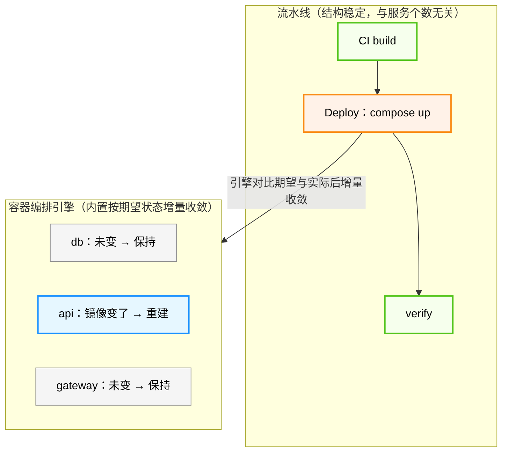

06 篇已经把生产变更收成 Job，并点明：自变量 $x$ 的**范围**决定跑哪些 Job——不是每次都全量打一遍。可当应用拆成网关、API、PostgreSQL 等多个服务后，**应用拓扑也被写进了流水线**：每个服务一段 `docker run`，再加验证，端口、卷、环境变量和启动顺序全挤在 Job 参数里。

这时缠在一起的是两件事。一是**拓扑**：谁依赖谁、网络和卷怎么连——这是应用结构，不该跟着某次交付变来变去。二是**按需发布**：这次只改了网关，还是动了库——生产上多个服务相对「该有的样子」差在哪，流水线并不知道。

用流水线编排拓扑，执行时往往只能二选一：**默认全量跑完所有 deploy Job**（稳，但没改动的服务也被卷进变更）；或靠**入参加开关**裁剪 Job。后者看起来「按需」，可判断 $x$、填对参数、盯住依赖，仍然压在运维身上——{{term:流水线引擎}}擅长按 DAG 调度动作，并不擅长管理生产变更里的**多服务状态变化**。

05 篇解决了单个容器怎么跑，06 / 07 篇解决了版本怎么构建、推送和触发。本篇把拓扑从流水线里拆出去：用{{term:容器编排}}引擎（以 {{term:Docker Compose}} 为代表）声明应用的{{term:期望状态}}并收敛，让流水线回到交付节奏。

## 问题：多服务之后，流水线里塞满了什么

把上面的处境写具体。沿用 06 篇的写法，三服务应用的部署流水线大致是这样：

```text
Job: deploy-db      → docker run postgres ...
Job: deploy-api     → docker run your-app ...   (depends on db)
Job: deploy-gateway → docker run nginx ...      (depends on api)
Job: verify         → curl /health
```

这里混着两类职责：

- **交付**：什么时候构建、推送、触发、验证，谁来审批——流水线该管。
- **拓扑与状态**：有哪些服务、谁依赖谁、网络和卷怎么连、这次该让哪些服务落到新版本——被塞进了同一串 Job。

于是每次上线，运维都要先回答「$x$ 动了哪几块」：只改网关配置，理论上跑 `deploy-gateway` 和 `verify`；改了数据库，还要想到谁依赖它。实务上更常见的是**嫌麻烦就全量执行**；想省事就给每个 Job 加「跑 / 跳过」入参——入口复杂了，**关注点没有少**：漏判、错参，线上就是一次隐蔽的不一致。

要拆开拓扑与交付，先得分清两套各司其职的引擎。

## 两套引擎：流水线引擎与容器编排引擎

流水线引擎在 06 篇已经按{{term:有向无环图}}（DAG）建模讲过，本篇不再展开；这里只把它与容器编排引擎并排放，看边界在哪里。二者的声明文件都进 Git，沿用{{term:基础设施即代码}}的版本化与审查方法；但 06 篇已区分：Jenkinsfile 是流水线即代码，管交付流程，只有 `compose.yaml` 才是应用拓扑的 IaC 落点。二者声明的对象不同：

| 维度 | 流水线引擎 | 容器编排引擎（Compose） |
| --- | --- | --- |
| 声明文件 | Jenkinsfile / Actions YAML | `compose.yaml` |
| 调度 / 收敛对象 | **Job** | **Service** |
| 图的含义 | Job 依赖 DAG | Service 依赖（谁先起、谁连谁） |
| 引擎职责 | 触发、并行、失败传播、日志与权限 | 建网、拉镜像、按依赖启动、按期望状态收敛 |
| 对人的问题 | 这次变更要跑哪些交付步骤？ | 应用期望长成什么样？ |
| 边界 | 不负责服务拓扑细节 | 不负责何时构建 / 推送 / 审批 |

流水线引擎不负责服务拓扑；容器编排引擎不负责何时构建、推送和审批。前者回答“这次交付怎么跑”，后者回答“应用应该是什么样”。后文提到 Compose，指的就是这一侧的引擎。

这条边界直接决定了下一个问题：既然服务拓扑归 Compose，流水线里的“Job”还剩什么？

## Job 单位怎么变：从 Pipeline Job 到 Compose Service

从 05 篇到本篇，调度与管理的最小单位一直在换：

```text
docker run 参数（05 篇：单容器怎么启动）
  → Job / Step（shell，06 篇：脚本里的动作）
  → Pipeline Job（流水线引擎，06 / 07 篇：交付流程的一段）
  → Compose Service 生命周期（容器编排引擎，本篇：应用里的一个运行单元）
  → Pipeline 仅保留 Deploy + Verify 等交付 Job
```

关键跃迁有两层，分两张图钉住：

1. **流水线结构变稳**：不再随服务个数膨胀成 `deploy-db` / `deploy-api` / `deploy-gateway`……固定成「构建 → Deploy → verify」。
2. **编排与增量收敛下沉到引擎**：Deploy 只触发 `docker compose up`；谁变谁重建、谁不变谁保持，由容器编排引擎按{{term:期望状态}}做对比与收敛——流水线不参与、运维在交付时也不用再点名业务容器。

**图 1 · 之前：拓扑散在流水线，结构随服务膨胀**



每加一个业务服务，流水线就多一个 deploy Job；全量跑或靠入参裁剪，运维都要盯 $x$。

**图 2 · 之后：流水线结构稳定；增量收敛在编排引擎内**



口径只有一条：`db`、`api`、`gateway` 是{{term:compose-service}}，**不是**流水线 Job。Service 描述“应用里跑什么”，Job 描述“交付流程跑哪一步”。二者用词不要混：

- 说“`api` 这个 Service 依赖 `db`”，不说“`api` Job 依赖 `db` Job”。
- 说“流水线里有 Deploy Job”，不说“流水线里有三个服务 Job”。

“职责下沉”之后，交付动作很薄：流水线触发 Deploy，引擎把实际状态收敛到声明；**运维在这一跳里关注的是执行结果——verify 是否通过**，而不是在流水线里编排或点检每个业务容器。组网、依赖顺序、改了谁动谁，都是编排引擎内部的事。

单位换完之后，Compose 具体声明什么、怎么声明，是接下来的主干。

## Compose 的本质：声明应用拓扑与期望状态

`docker run` 是**命令式**：你告诉系统每一步怎么做。`compose.yaml` 是**声明式**：你描述{{term:期望状态}}，由 Compose 把实际状态收敛过去。05 篇把“装环境 + 拷产物 + 写配置 + 起服务”折叠成一条 `docker run`；本篇把 n 条 `docker run` 折叠成一条 `docker compose up`——无论应用由 3 个还是 30 个服务组成，运维动作集合不变：`up`、`ps`、`logs`、`down`。

几类工具的职责可以这样分开：

| 层次 | 解决的问题 |
| --- | --- |
| Docker Image | 服务运行什么 |
| Container | 服务运行实例 |
| Docker Compose | 多个服务如何组成一个应用 |
| Jenkinsfile / GitHub Actions | 什么时候构建、推送和部署 |
| Kubernetes | 多机调度、弹性扩缩和故障自愈 |

最小可用的三服务示例：

```yaml
services:
  db:
    image: postgres:16-alpine
    environment:
      POSTGRES_PASSWORD: ${POSTGRES_PASSWORD}  # Injected from .env, never hard-coded
    volumes:
      - pgdata:/var/lib/postgresql/data         # Named volume keeps data across recreate

  api:
    image: your-registry/your-app:1.0.0
    environment:
      DB_URL: jdbc:postgresql://db:5432/app     # Service name resolves via Compose network
    depends_on:
      - db                                       # Start order only, not readiness

  gateway:
    image: nginx:1.27-alpine
    ports:
      - "80:80"
    volumes:
      - ./nginx.conf:/etc/nginx/conf.d/default.conf:ro
    depends_on:
      - api

volumes:
  pgdata:
```

日常只需要四条命令：

```bash
docker compose up -d        # Create network, pull missing images, start by dependency
docker compose ps           # Show status
docker compose logs -f      # Follow logs
docker compose down         # Remove containers and network (volumes kept by default)
```

`depends_on` 默认只保证启动顺序，不保证数据库已经可以接受连接。生产配置应为依赖服务增加 `healthcheck`，并让应用自身具备连接重试能力；容器显示 `Up`，不代表应用真正就绪。

和手动 `docker run` 相比：

| 维度 | 手动 `docker run` | Docker Compose |
| --- | --- | --- |
| 配置管理 | 散落在命令行 | YAML 进 Git，可追溯 |
| 启动方式 | 逐个敲，记依赖顺序 | 一条命令，`depends_on` 声明顺序 |
| 环境一致性 | 每次手敲易错 | 同一份 YAML 本地 / 测试 / 生产同构 |
| 停止清理 | 逐个 `stop` + `rm` | `docker compose down` |
| 团队协作 | 靠文档或口口相传 | `clone` + `compose up` 即可复现 |

Compose 文件通常命名为 `compose.yaml`；`docker-compose.yml` 是历史命名，现代 Docker Compose 仍兼容。对多数开源项目而言，`compose.yaml`、环境变量模板和启动说明随源码一起发布，用户准备好 Docker 就能 `docker compose up -d`——Compose 文件是项目交付物，不是临时脚本。

最小模型之外，来看一个更完整的真实拓扑。

## 本站级示例：多服务可观测性栈

本仓库实际用 Compose 声明了网关、站点与可观测性套件（示意结构）：

| 服务 | 作用 |
| --- | --- |
| Nginx 网关 | 反向代理、入口 |
| VitePress 站点 | 文档站容器 |
| Prometheus / Grafana | 指标与面板 |
| Loki + Promtail | 日志采集与存储 |

完整 YAML 随项目仓库版本管理，新人不必背命令，只需读文件。这正是 07 篇说的“运维左移”：上线拓扑从某个人的脑子里，变成仓库里的显性代码。

> 生产密钥不要写进 YAML 明文。用 `.env`（加入 `.gitignore`）或密钥管理注入；YAML 里只写 `${POSTGRES_PASSWORD}` 这类引用。

有了声明，每次变更时 Compose 具体怎么把现状推向声明？

## 期望状态如何收敛

`docker compose up -d` 会对比 `compose.yaml` 与当前运行状态：**创建缺失的 Service，重建配置或镜像有变更的 Service，未变化的 Service 保持运行**。人不再需要判断变更范围，只需把期望状态改对。

例如只把 `api` 的镜像从 `1.0.0` 升到 `1.0.1`：

```yaml
services:
  api:
    image: your-registry/your-app:1.0.1  # Bumped from 1.0.0
```

执行 `docker compose up -d` 后：

| Service | 行为 | 原因 |
| --- | --- | --- |
| `db` | 保持运行 | 配置未变化 |
| `api` | 重建并重启 | 镜像版本变化 |
| `gateway` | 保持运行 | 配置未变化 |

这套行为带来三个后果：

- **状态连续**：未变化的 Service 不中断。
- **变更可预测**：改什么动什么，不动的不碰。
- **回滚即切换**：`git checkout` 旧版本的 `compose.yaml`，再 `docker compose up -d`。

需要说明的是，Compose 只在你执行 `up` 时做一次对比与收敛，并不持续监控、自动纠偏；更完整的持续 reconciliation 是 Kubernetes 的形态，本篇不展开。

命令式与声明式的差别也落在这里：

| 维度 | 命令式（05 / 06 篇） | 声明式（本篇） |
| --- | --- | --- |
| 变更单位 | 操作（pull / run / stop / rm） | 状态（`compose.yaml`） |
| 人告诉系统 | 怎么做 | 要什么 |
| 结果保证 | 依赖操作序列正确 | 依赖引擎收敛 |
| 回滚方式 | 反向操作，易错 | 切换 YAML 版本，可追溯 |

期望状态有了引擎托底，流水线那一侧就可以变薄。

## 流水线如何被打薄

Compose 不替代流水线，而是把“应用拓扑如何部署”从流水线脚本里抽出去，流水线只调用它。06 篇的遗留问题是：改了哪个服务，就要人来决定跑哪些 Job；Compose 接管之后，这个判断由 `up` 的对比完成。CD 形态收成：

```text
git push
  → CI：构建镜像并推送仓库（06 / 07 篇）
  → CD：git pull → docker compose up -d（本篇）
  → CD：curl /health（verify，保持不变）
```

这时流水线只剩构建推送、部署触发和验证三个交付阶段；`db`、`api`、`gateway` 的启停顺序留在 `compose.yaml` 里。

### 全量 up 还是指定服务

| 方式 | 命令 | 行为 |
| --- | --- | --- |
| 全量 up | `docker compose up -d` | 对比所有 Service，**只重建有变化的** |
| 指定服务 up | `docker compose up -d gateway` | 只处理 `gateway` 及其依赖 |

- **方案 A：全量 up（交付最佳实践）。** CD 固定一条 `docker compose up -d`。流水线不必判断“这次改了哪个服务”；增量收敛由编排引擎完成——只改了 `api` 时，`db` / `gateway` 保持运行。CI 推哪些镜像可以另说：即使 CI 只构建变更服务的镜像，全量 `up` 依然成立（未变更服务的镜像标签没变，引擎不会重建它们）。
- **方案 B：指定服务 up。** 更常见于**本地开发调试**：你明确只想动某一个服务，用 `up -d <service>` 缩短反馈环。若把“感知变更范围、只 up 某几个服务”写回生产 CD，流水线又拾回 06 篇的复杂度，一般不当作交付默认路径。

### Build in Server 与 CI Build

服务器仍然可以只装 Docker，不装 `mvn` / `pip`，由 Dockerfile 和 Compose 在服务器上完成构建，这就是 **Build in Server**：源码到服务器后执行 `docker compose up --build -d`，适合个人项目、开源项目和单机小规模部署。

规模扩大后，切换为 **CI Build**：流水线构建并推送**新标签**镜像，服务器执行 `docker compose up -d` 即可。`up` 默认按 pull 策略处理镜像（常见为缺本地镜像才拉）；`compose.yaml` 里把 `api:1.0.0` 改成 `api:1.0.1` 且本地没有 `1.0.1` 时，一条 `up -d` 会拉新镜像并做增量收敛，**不必再写一条独立的 `docker compose pull`**。两种模式都由 Compose 负责服务拓扑和生命周期，差别只在镜像在哪里构建。

单独的 `pull`（或 `up --pull always`）主要用在**可变标签**场景：例如一直写 `:latest`、或同名标签在仓库里被覆盖推送——本地已有同名镜像时，默认 `up` 不会重新拉取。本系列推荐不可变标签（版本号），交付路径以一条 `up -d` 为准。

Build in Server 的代价要明确：构建会消耗生产机的 CPU、内存和磁盘，结果还可能受服务器环境影响。需要多环境复用、构建审计、快速回滚或避免争抢生产资源时，应切换到 CI Build。

部署前建议先检查最终配置，再执行变更：

```bash
docker compose config        # Validate and print the merged config
docker compose up -d         # Pull missing images by policy, then converge
docker compose ps
docker compose logs --tail=100
```

流水线变薄之后，Compose 能走多远，也该说清楚。

## 单机多服务部署的终点与边界

| 场景 | 建议 |
| --- | --- |
| 个人 / 中小项目，单机部署或多台机器分别独立部署 | **Compose 足够**——单机多服务部署的终点 |
| 数十服务、多节点、弹性扩缩 | 再考虑 K3s / Kubernetes |
| 多区域容灾、灰度发布 | Service Mesh / GitOps（进阶篇） |

Compose 的边界有两层：

- **规模边界**：它管单机、多容器应用，不是多机集群的调度方案。引入 Kubernetes 的决策点不是服务数量，而是运维复杂度是否超出单机可管理范围。多数中小项目终身不需要。
- **职责边界**：容器编排不等于流水线调度。Compose 不决定何时构建、推送和审批，这些仍由流水线引擎负责。

01–07 加上 Compose，已经能覆盖绝大多数中小型项目的单机部署，这也是基础篇把它放在最后一篇的原因。

## 流程旁白

开发把镜像版本或拓扑变更推进仓库后，流水线负责触发，Compose 在目标机上按声明收敛；交付侧看 verify 是否通过即可。合并审查发生在进仓库之前，不是上线时再逐条点检 YAML。密钥、权限和回滚仍要单独约定——工具把拓扑收敛自动化了，并不自动解决谁有权改生产、失败后谁处置。

## 小结

Docker Compose 把 05 的单容器能力扩展为多服务期望状态：一份 `compose.yaml`、一条 `up`、一键 `down`。它与 06 / 07 的流水线引擎声明文件都进 Git、沿用 IaC 的版本化与审查方法，却分管两件事：流水线引擎调度 Job，管交付节奏；容器编排引擎收敛 Service，管应用拓扑。分清两者，流水线才能回到构建、部署触发与验证。

下一步进入 [第 09 篇 · 基础篇总结](./09-foundation-summary.md)：回顾 01–08 的范式跃迁、能力清单，以及“够用”与“还差得远”的边界。

## 思考

1. **双引擎边界**：团队想在 `compose.yaml` 里加一条“合并到 main 后才允许部署”，在 Jenkinsfile 里加一个新的 `cache` 服务。这两件事各放错了位置——为什么？该分别放到哪里？
2. **安全边界**：`compose.yaml` 里有数据库密码时，是写进 `.env` 还是用密钥管理？两者各自适合什么场景？
3. **就绪与启动**：`depends_on` 只保证启动顺序，PostgreSQL 容器显示 `Up` 但还在初始化，应用连库会怎样？如何用 `healthcheck` 解决？

## 延伸阅读：从启动顺序到按需编排

### 健康检查与优雅启停

`depends_on` 只管顺序，生产级 Compose 文件应为数据库、缓存等有状态服务添加 `healthcheck`，并让应用具备连接重试能力。优雅停服同理：`docker compose down` 默认发送 SIGTERM，应用需要捕获信号完成收尾（刷盘、断开连接），超时后才会收到 SIGKILL。健康检查不是“配了就安全”——真正的就绪保证需要 `healthcheck` 与应用重试两层配合。

推荐阅读：[Control startup and shutdown order in Compose](https://docs.docker.com/compose/how-tos/startup-order/)

### profiles 与 include：按需启用

多数项目只需要 Compose 的核心子集，以下功能按场景启用：

- **profiles**：按需启动服务子集，例如 `docker compose --profile monitoring up` 只启动 Prometheus / Grafana，日常开发不占资源。
- **include**：跨文件组合，把可观测性栈拆到独立文件，主文件 include，保持核心拓扑清晰。

推荐阅读：[Use service profiles](https://docs.docker.com/compose/how-tos/profiles/)、[Include](https://docs.docker.com/compose/how-tos/multiple-compose-files/include/)

## 参考

1. [Docker Compose 官方文档](https://docs.docker.com/compose/)
2. [Compose Specification](https://github.com/compose-spec/compose-spec/blob/main/spec.md)
3. [docker compose up 命令参考](https://docs.docker.com/reference/cli/docker/compose/up/)
4. [Compose CLI 参考](https://docs.docker.com/reference/cli/docker/compose/)
